## Triển khai ứng dụng web (Spring Boot) và database (MySQL) trên 2 máy ảo
### 1. Mô hình triển khai

Ứng dụng được triển khai theo mô hình hai máy ảo tách biệt: một máy chạy ứng dụng Spring Boot, một máy chạy cơ sở dữ liệu MySQL. Hai máy giao tiếp qua mạng NAT của VMware.

```text
┌─────────────────────┐        HTTP :8081         ┌─────────────────────────┐
│  Windows (trình duyệt)│ ───────────────────────▶ │  ubuntu-lab-01           │
│  Host                │                           │  192.168.140.129         │
└─────────────────────┘                           │  Spring Boot 3.2.5       │
                                                  │  Java 21, chạy bằng      │
                                                  │  systemd (apartment)     │
                                                  └────────────┬────────────┘
                                                               │ JDBC :3306
                                                               ▼
                                                  ┌─────────────────────────┐
                                                  │  ubuntu-lab-03           │
                                                  │  192.168.140.132         │
                                                  │  MySQL 8.4.13            │
                                                  │  Database: estatebasic   │
                                                  └─────────────────────────┘
```

| Thành phần | Máy | Địa chỉ | Cổng | Vai trò |
|---|---|---|---|---|
| Trình duyệt | Windows (Host) | — | — | Gửi yêu cầu HTTP đến ứng dụng |
| Ứng dụng Spring Boot | ubuntu-lab-01 | 192.168.140.129 | 8081 | Nhận yêu cầu, xử lý nghiệp vụ, trả giao diện và dữ liệu |
| Cơ sở dữ liệu MySQL | ubuntu-lab-03 | 192.168.140.132 | 3306 | Lưu trữ dữ liệu tòa nhà, người dùng |

Luồng xử lý một yêu cầu:

1. Trình duyệt trên Windows mở `http://192.168.140.129:8081/building-search.html`.
2. Ứng dụng trên `ubuntu-lab-01` nhận yêu cầu và gọi API `/api/building`.
3. Ứng dụng kết nối đến `ubuntu-lab-03:3306` bằng tài khoản `apartment` và truy vấn database `estatebasic`.
4. Kết quả được trả ngược về trình duyệt dưới dạng dữ liệu hiển thị trên trang.

Lý do tách hai máy: database và ứng dụng có vòng đời và tài nguyên khác nhau. Tách ra giúp mỗi máy có thể được cấu hình, theo dõi và sao lưu riêng, đồng thời mô phỏng cách triển khai thực tế trong môi trường cloud.
### 2. Database server (ubuntu-lab-03): cài MySQL, nạp dữ liệu, tạo user
#### 2.1. Cập nhật danh sách gói và cài MySQL Server
* `sudo apt update` cập nhật danh sách gói phần mềm từ kho của Ubuntu.
* `sudo apt install -y mysql-server` cài MySQL Server (phiên bản 8.4.13). Cờ `-y` tự đồng ý các câu hỏi xác nhận.

```bash
sudo apt update
sudo apt install -y mysql-server
```

#### 2.2. Kiểm tra dịch vụ MySQL
```bash
sudo systemctl status mysql --no-pager
```

* `Loaded: enabled`: MySQL được cài và tự khởi động cùng hệ điều hành.
* `Active: active (running)`: MySQL đang chạy.
* `Server is operational`: MySQL sẵn sàng nhận yêu cầu.

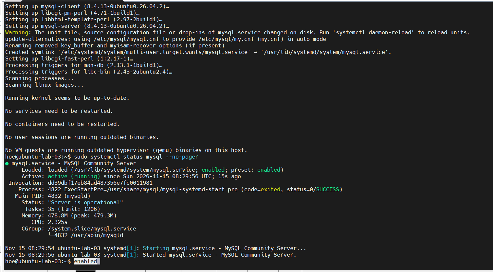

* Tại thời điểm này, MySQL chỉ lắng nghe ở `127.0.0.1`, tức chỉ chấp nhận kết nối từ chính máy `ubuntu-lab-03`. Mục 2.3 sẽ mở cổng để máy `ubuntu-lab-01` kết nối được.
#### 2.3. Cho phép máy khác kết nối tới MySQL
* Mặc định MySQL chỉ lắng nghe ở `127.0.0.1`. Để máy ứng dụng `ubuntu-lab-01` kết nối được, sửa tham số `bind-address` trong file cấu hình thành `0.0.0.0` (lắng nghe trên mọi địa chỉ IP của máy).

```bash
sudo sed -i 's/^bind-address.*/bind-address = 0.0.0.0/' /etc/mysql/mysql.conf.d/mysqld.cnf
sudo systemctl restart mysql
sudo ss -tlnp | grep 3306
```

* Lệnh `ss -tlnp` cho thấy MySQL đang lắng nghe ở `0.0.0.0:3306`, tức cổng 3306 đã mở cho mọi địa chỉ trong mạng.
* Cổng `127.0.0.1:33060` là cổng phụ của MySQL (X Protocol), không ảnh hưởng đến kết nối ứng dụng.

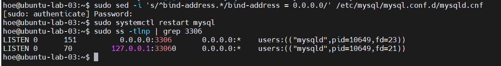

> Lưu ý bảo mật: mở `0.0.0.0` chỉ là bước cần thiết cho lab. Ở môi trường thực tế cần giới hạn bằng firewall (ufw) để chỉ cho phép đúng IP của máy ứng dụng truy cập cổng 3306, và chỉ cấp quyền cho user đúng địa chỉ (mục 2.4).
#### 2.4. Nạp dữ liệu mẫu và tạo user cho ứng dụng
* Tải file `estateFin4.sql` từ repo GitHub của dự án về máy, rồi nạp vào MySQL. File này tạo database `estatebasic` gồm 16 bảng và dữ liệu mẫu.

```bash
wget https://raw.githubusercontent.com/caoconghoe/caoconghoe-my-apartment-project-backend/main/src/main/resources/static/images/estateFin4.sql
sudo mysql < estateFin4.sql
```

* Kiểm tra: database có 16 bảng và 11 tài khoản mẫu (manager01, staff01–staff07, customer01–customer03).

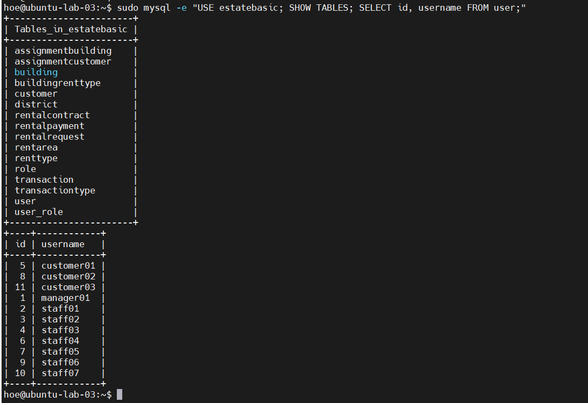

* Không dùng tài khoản `root` cho ứng dụng. Tạo user `apartment` chỉ được đăng nhập từ IP của máy ứng dụng (`192.168.140.129`), và chỉ có quyền trên database `estatebasic`:

```bash
sudo mysql -e "CREATE USER 'apartment'@'192.168.140.129' IDENTIFIED BY 'Apt@2026';"
sudo mysql -e "GRANT ALL PRIVILEGES ON estatebasic.* TO 'apartment'@'192.168.140.129'; FLUSH PRIVILEGES;"
sudo mysql -e "SELECT user, host FROM mysql.user WHERE user='apartment';"
```

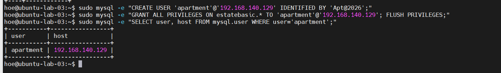

* Nguyên tắc phân quyền tối thiểu: ứng dụng chỉ có quyền cần thiết, nếu bị lộ thì phạm vi thiệt hại nhỏ.
### 3. App server (ubuntu-lab-01): cài Java/Maven, build, chạy ứng dụng

#### 3.1. Cài Java 21, Maven, Git và MySQL client
```bash
sudo apt update
sudo apt install -y openjdk-21-jdk-headless maven git mysql-client
java -version
mvn -version
```
* Ứng dụng viết bằng Java 21 nên cần JDK 21. Maven là công cụ build, dùng để tải thư viện và đóng gói code thành file `.jar`.
* Kết quả: Java 21.0.13 (OpenJDK) và Maven 3.9.12 chạy bình thường.

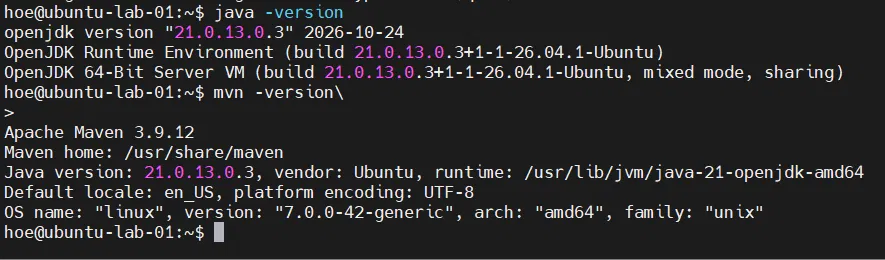

#### 3.2. Kiểm tra kết nối từ app server sang database server
```bash
mysql -h 192.168.140.132 -u apartment -p'<mật khẩu>' -e "SELECT COUNT(*) AS so_toa_nha FROM estatebasic.building;"
```
* Lệnh truy vấn bảng `building` trên máy `ubuntu-lab-03` từ máy `ubuntu-lab-01`, trả về **24 tòa nhà**.
* Kết quả này chứng minh hai máy ảo kết nối được với nhau qua cổng 3306, và user `apartment` có quyền đọc dữ liệu từ xa.
* Cảnh báo "Using a password on the command line is insecure" là gợi ý an toàn của MySQL khi truyền mật khẩu trên dòng lệnh. Trong môi trường lab có thể bỏ qua; môi trường thật nên dùng file cấu hình hoặc nhập mật khẩu tương tác.

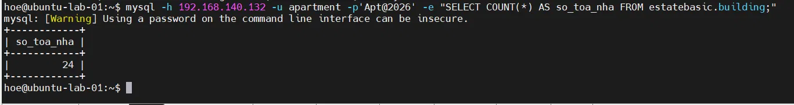
### 4. Build ứng dụng thành file .jar
```bash
git clone https://github.com/caoconghoe/caoconghoe-my-apartment-project-backend.git
cd caoconghoe-my-apartment-project-backend
mvn -B package -DskipTests
ls -lh target/*.jar
```
* `git clone`: tải mã nguồn từ GitHub về máy ảo.
* `mvn package`: Maven tải thư viện theo `pom.xml`, biên dịch mã Java, rồi đóng gói thành file `.jar`. Tham số `-DskipTests` bỏ qua bước chạy unit test để build nhanh hơn.
* Kết quả: `BUILD SUCCESS` sau 1 phút 9 giây, tạo file `Apartment-Project-1.0-SNAPSHOT.jar` nặng 49 MB.
* Spring Boot đóng gói luôn toàn bộ thư viện vào trong file `.jar` (thư mục `BOOT-INF/`), nên chạy được bằng `java -jar` mà không cần cài thêm gì trên máy.

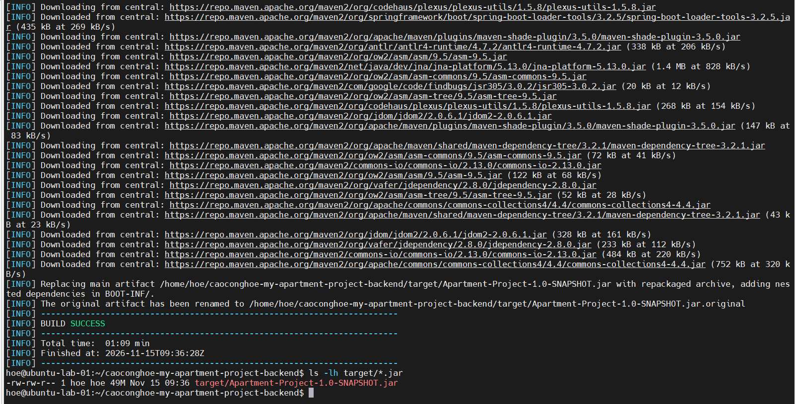

### 5. Chạy ứng dụng
```bash
SPRING_DATASOURCE_URL="jdbc:mysql://192.168.140.132:3306/estatebasic?useSSL=false&allowPublicKeyRetrieval=true&serverTimezone=UTC" \
SPRING_DATASOURCE_USERNAME=apartment \
SPRING_DATASOURCE_PASSWORD='<mật khẩu>' \
java -jar target/Apartment-Project-1.0-SNAPSHOT.jar
```
* Thông tin kết nối database không được ghi cứng trong code. Ứng dụng đọc từ biến môi trường (`SPRING_DATASOURCE_*`) lúc chạy. Nhờ vậy cùng một file `.jar` có thể chạy ở nhiều môi trường khác nhau mà không cần build lại.
* Biến `SPRING_DATASOURCE_URL` trỏ sang `192.168.140.132`, tức máy database, thay vì `localhost` như cấu hình gốc của dự án.
* Kết quả: Tomcat khởi động trên cổng 8081, ứng dụng khởi động trong 4.047 giây.

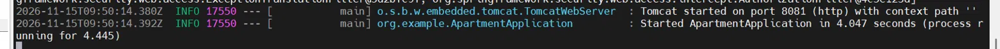

* Kiểm tra trên trình duyệt của máy thật tại `http://192.168.140.129:8081/building-search.html` để xác nhận trang web lấy được dữ liệu từ database.

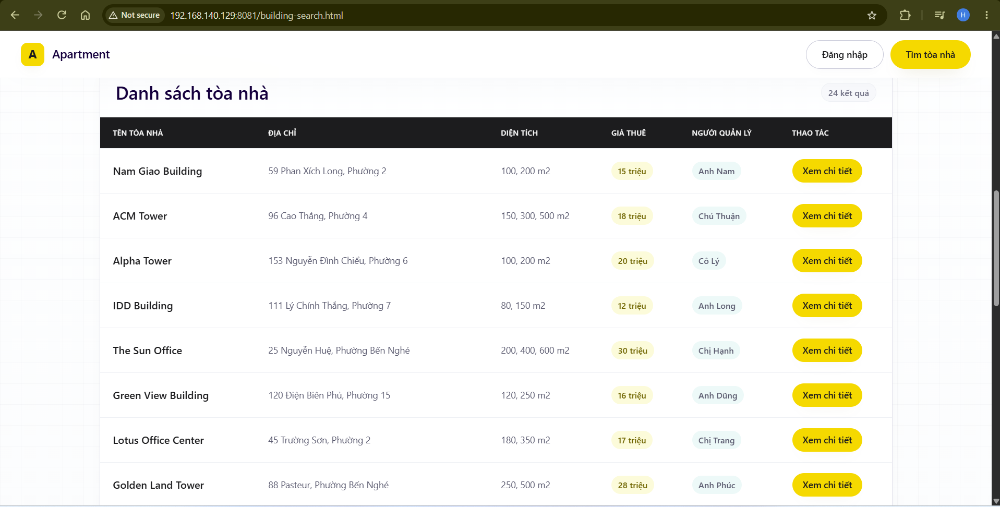

## 6. Chạy app như một service systemd

Mục tiêu: app tự khởi động cùng máy và tự chạy lại nếu bị dừng bất thường.

### 6.1. Chép file jar vào thư mục triển khai

```bash
sudo mkdir -p /opt/apartment
sudo cp target/Apartment-Project-1.0-SNAPSHOT.jar /opt/apartment/app.jar
```

### 6.2. Tạo file cấu hình biến môi trường

File này chứa thông tin kết nối database, tách khỏi mã nguồn. Quyền `600` để chỉ root đọc được.

```bash
sudo tee /opt/apartment/app.env > /dev/null <<'EOF'
SPRING_DATASOURCE_URL=jdbc:mysql://192.168.140.132:3306/estatebasic?useSSL=false&allowPublicKeyRetrieval=true&serverTimezone=UTC
SPRING_DATASOURCE_USERNAME=apartment
SPRING_DATASOURCE_PASSWORD=<mật khẩu>
EOF
sudo chmod 600 /opt/apartment/app.env
sudo ls -l /opt/apartment/app.env
```


### 6.3. Tạo file service systemd

```bash
sudo tee /etc/systemd/system/apartment.service > /dev/null <<'EOF'
[Unit]
Description=Apartment Spring Boot App
After=network-online.target
Wants=network-online.target

[Service]
User=hoe
WorkingDirectory=/opt/apartment
EnvironmentFile=/opt/apartment/app.env
ExecStart=/usr/bin/java -jar /opt/apartment/app.jar
Restart=always
RestartSec=5

[Install]
WantedBy=multi-user.target
EOF
```

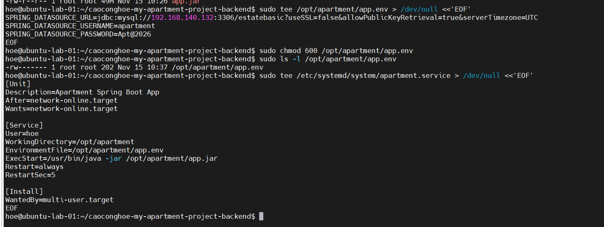

Ý nghĩa các dòng chính:

- `After` và `Wants`: chờ mạng sẵn sàng rồi mới khởi động app.
- `User=hoe`: app chạy bằng user thường, không chạy bằng root.
- `EnvironmentFile`: nạp thông tin database từ file `app.env`.
- `ExecStart`: lệnh chạy app, tương đương `java -jar` đã làm ở mục 5.
- `Restart=always` và `RestartSec=5`: nếu app dừng, systemd tự chạy lại sau 5 giây.
- `WantedBy=multi-user.target`: bật service khi máy khởi động.

### 6.4. Nạp cấu hình, bật và khởi động service

Trước bước này phải tắt chương trình `java -jar` đang chạy thủ công ở mục 5 (`Ctrl+C`), nếu không cổng 8081 sẽ bị trùng.

```bash
sudo systemctl daemon-reload
sudo systemctl enable --now apartment
sudo systemctl status apartment --no-pager
```

Kết quả mong đợi: dòng `Active:` hiện `active (running)`.

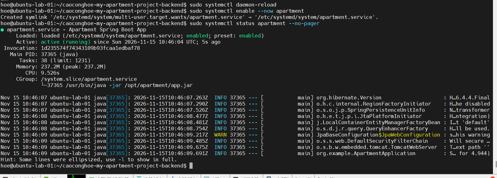

---

## 7. Kết luận

- Đã tạo 2 máy ảo Ubuntu trong VMware, cấu hình mạng NAT, Host-only và Bridged, kiểm tra kết nối SSH giữa 2 máy.
- Đã triển khai ứng dụng Spring Boot trên `ubuntu-lab-01` và cơ sở dữ liệu MySQL trên `ubuntu-lab-03`, hai máy giao tiếp qua mạng nội bộ.
- Ứng dụng chạy dưới dạng service systemd, tự khởi động cùng máy và tự chạy lại khi bị dừng.
- Kiến trúc đã triển khai: trình duyệt → `ubuntu-lab-01:8081` (Spring Boot) → `ubuntu-lab-03:3306` (MySQL).

