# Lab: Tạo máy ảo Ubuntu Server trên VMware

## Mục lục

- [Phần 1: Tạo máy ảo bằng VMware](#phần-1-tạo-máy-ảo-bằng-vmware)
- [Phần 2: Cài đặt Ubuntu Server](#phần-2-cài-đặt-ubuntu-server)
- [Phần 3: Cấu hình và kiểm tra máy ảo](#phần-3-cấu-hình-và-kiểm-tra-máy-ảo)

---

## Phần 1: Tạo máy ảo bằng VMware

### Bước 1: Mở trình tạo máy ảo

- Vào **File → New Virtual Machine…** → chọn **Custom**.

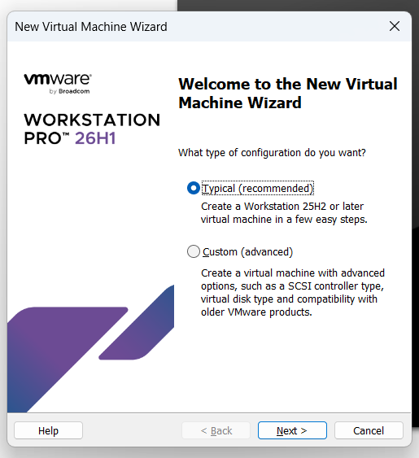

### Bước 2: Chọn phiên bản phần cứng ảo

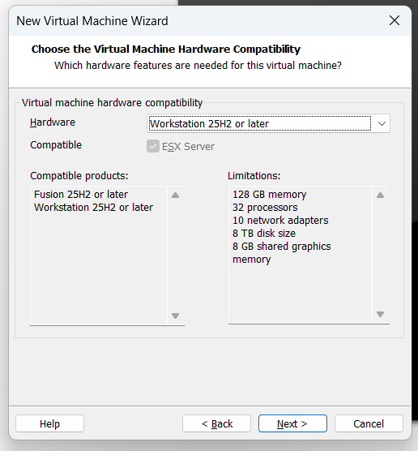

### Bước 3: Chọn nguồn cài hệ điều hành

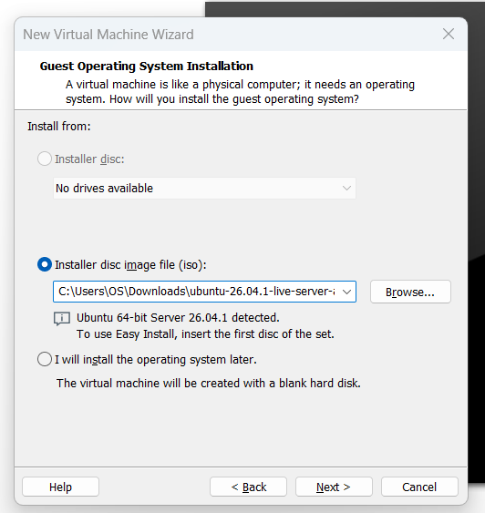

### Bước 4: Đặt tên và nơi lưu

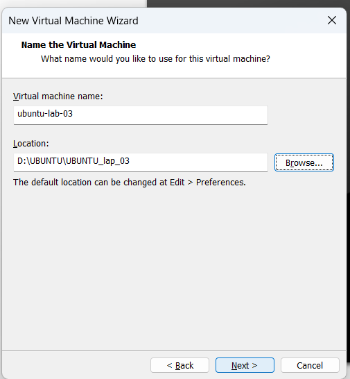

### Bước 5: Cấu hình CPU

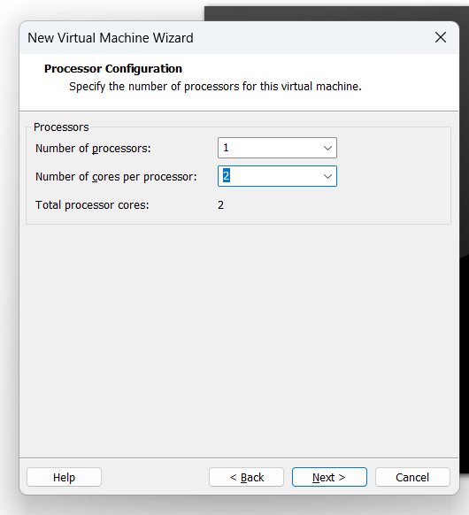

### Bước 6: Cấu hình RAM

- Đặt **3 GB**.

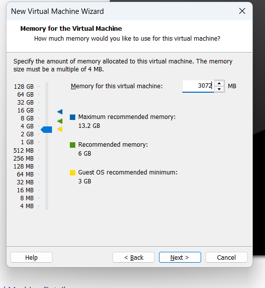

### Bước 7: Chọn kiểu mạng

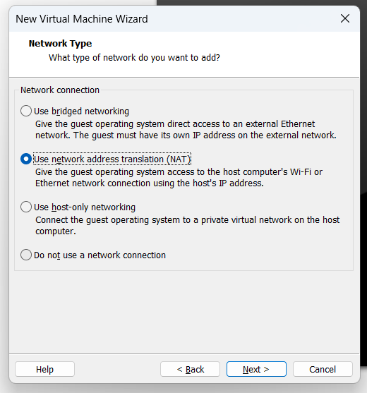

### Bước 8: Chọn bộ điều khiển và loại ổ đĩa

| Thiết lập         | Giá trị                                                    |
| ----------------- | ---------------------------------------------------------- |
| I/O Controller    | LSI Logic (mặc định)                                       |
| Disk type         | SCSI (mặc định), khớp với Hard Disk (SCSI) trong ảnh       |
| Disk              | Create a new virtual disk                                  |
| Maximum disk size | 25 GB                                                      |
| Lưu trữ           | Store virtual disk as a single file                        |

### Bước 9: Xem lại cấu hình và hoàn tất

- Bấm **Finish** để tạo máy ảo.

---

## Phần 2: Cài đặt Ubuntu Server

### Bước 10: Cài Ubuntu Server

- Bấm **Power on this virtual machine**, máy ảo khởi động vào trình cài đặt Ubuntu.
- Click vào màn hình máy ảo để thao tác (phím mũi tên, `Tab`, `Enter`); nhấn `Ctrl + Alt` để đưa chuột ra ngoài.
- Các màn hình cơ bản giữ mặc định:
  - Ngôn ngữ: **English**
  - Bàn phím: **English (US)**
  - Kiểu cài: **Ubuntu Server**
  - Proxy: để trống
  - Mirror: mặc định
  - Ubuntu Pro: chọn **Skip for now**
  - Featured snaps: không chọn

#### 10.1. Cấu hình mạng

- Card mạng `ens33` tự nhận IP qua DHCP từ mạng NAT của VMware (`192.168.x.x`).

#### 10.2. Phân vùng ổ đĩa

- Chọn **Use an entire disk** trên ổ `/dev/sda` 25 GB (ổ đĩa ảo, không ảnh hưởng máy thật).
- Tick **Set up this disk as an LVM group**: LVM (Logical Volume Manager) cho phép thay đổi kích thước phân vùng linh hoạt, ví dụ mở rộng phân vùng khi tăng dung lượng vDisk mà không cần cài lại.
- Không mã hoá LUKS vì là môi trường lab.
- Màn hình **Confirm destructive action** → **Continue**.

#### 10.3. Tạo tài khoản người dùng

| Trường              | Giá trị         | Ghi chú                                                                                                                      |
| ------------------- | --------------- | ---------------------------------------------------------------------------------------------------------------------------- |
| Your name           | Cao Cong Hoe    | Tên hiển thị                                                                                                                 |
| Your server's name  | `ubuntu-lab-03` | Hostname – tên máy dùng để nhận diện khi giao tiếp với các máy khác trong mạng; đặt trùng tên máy ảo để dễ quản lý           |
| Username            | `hoe`           | Tên đăng nhập, viết thường, không dấu, không khoảng trắng                                                                    |
| Password            | *(ẩn)*          | Mật khẩu dùng để đăng nhập và chạy lệnh quản trị `sudo`                                                                      |

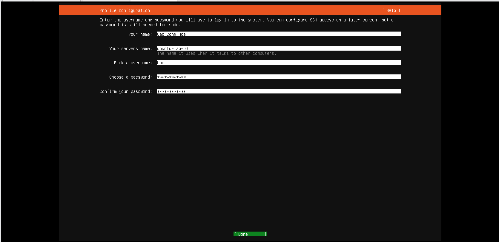

#### 10.4. Cài OpenSSH server

- Tick **Install OpenSSH server**: cài dịch vụ SSH (Secure Shell) để quản trị máy ảo từ xa qua kết nối được mã hoá, dùng các công cụ như MobaXterm, PuTTY hoặc lệnh `ssh`.
- **Allow password authentication over SSH**: cho phép đăng nhập SSH bằng username/password đã tạo ở bước 10.3.
- **Import SSH key**: bỏ qua. Đây là cách đăng nhập bằng cặp khoá (public/private key), an toàn hơn mật khẩu và thường dùng trong môi trường thực tế; môi trường lab dùng mật khẩu cho đơn giản.
- Sau khi cài xong, kết nối từ máy thật bằng lệnh:

```bash
ssh hoe@<IP máy ảo>
```

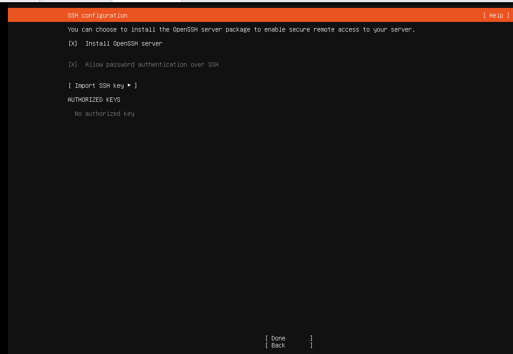

#### 10.5. Hoàn tất cài đặt

- Nhấn `Enter` vào **[ Reboot Now ]**.

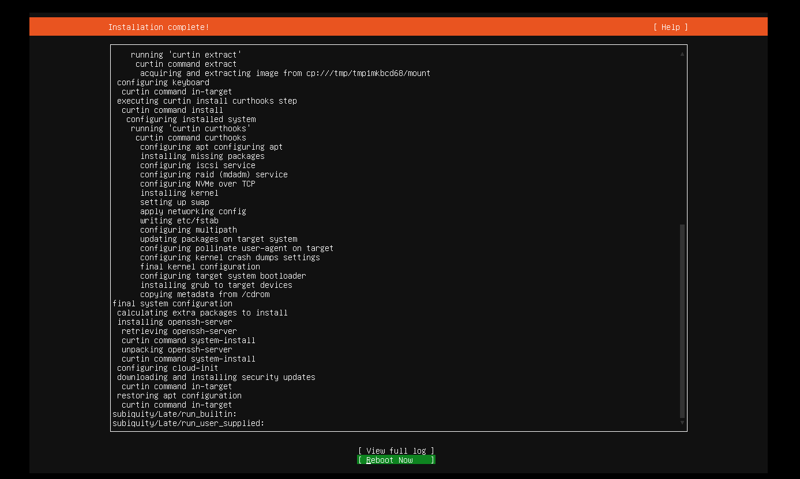

### Bước 11: Đăng nhập và kết nối SSH

- Sau khi khởi động lại, đăng nhập bằng tài khoản `hoe`; bấm **I Finished Installing** để VMware ngắt file ISO.
- Kết nối SSH từ máy thật bằng MobaXterm: **Session → SSH**
  - Remote host: `192.168.140.132`
  - Username: `hoe`
  - Port: `22`
- Kết nối thành công, máy thật truy cập được máy ảo qua card **VMnet8** của mạng NAT. Cột bên trái MobaXterm hiển thị thư mục của máy ảo qua SFTP, dùng để truyền file.

---

## Phần 3: Cấu hình và kiểm tra máy ảo

### Bước 12: Mở rộng phân vùng gốc bằng LVM

- Sau khi cài, phân vùng `/` chỉ có **11.21 GB** (dùng 47.5%) trên ổ 25 GB, do trình cài Ubuntu mặc định chỉ cấp khoảng một nửa dung lượng cho logical volume `ubuntu-lv`.
- Mở rộng logical volume dùng toàn bộ dung lượng còn trống trong volume group:

```bash
sudo lvextend -r -l +100%FREE /dev/ubuntu-vg/ubuntu-lv
```

| Tuỳ chọn       | Ý nghĩa                                                  |
| -------------- | -------------------------------------------------------- |
| `-l +100%FREE` | Dùng hết dung lượng còn trống                            |
| `-r`           | Tự động mở rộng luôn filesystem ext4 (`resize2fs`)       |

- **Kết quả:** logical volume tăng từ **11.50 GiB** lên **23.00 GiB**, filesystem được mở rộng trực tuyến khi hệ thống đang chạy, không cần khởi động lại.
- Kiểm tra bằng `df -h /`: dung lượng **23G**, đã dùng **5.4G (25%)**.

> **Ưu điểm của LVM:** thay đổi kích thước phân vùng linh hoạt mà không phải cài lại hệ điều hành.

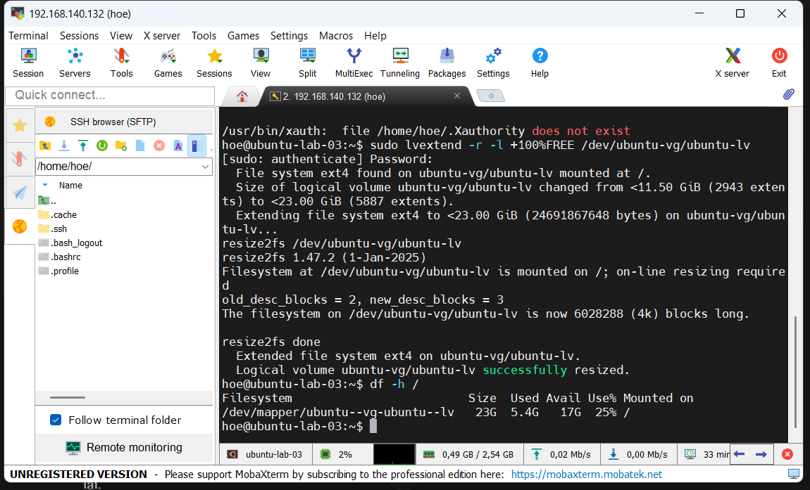

### Bước 13: Kiểm tra cấu hình máy ảo

Chạy các lệnh kiểm tra:

```bash
hostnamectl
lscpu
free -h
lsblk
ip -br a
ping -c 3 google.com
```

| Thành phần | Kết quả                                                                                                                                                                                                                                                                                                |
| ---------- | ------------------------------------------------------------------------------------------------------------------------------------------------------------------------------------------------------------------------------------------------------------------------------------------------------ |
| Hostname   | `ubuntu-lab-03`, hệ điều hành Ubuntu 26.04.1 LTS                                                                                                                                                                                                                                                       |
| CPU        | CPU(s) = 2, Socket(s) = 1, Core(s) per socket = 2, Thread(s) per core = 1 → 2 vCPU = 1 socket × 2 core × 1 thread, đúng cấu hình ở Bước 5. Model name hiển thị CPU vật lý của máy thật (Intel Core i5-13500H) do vCPU chạy trực tiếp trên CPU vật lý nhờ công nghệ ảo hoá phần cứng Intel VT-x.       |
| RAM        | Total 2.5Gi, đang dùng 497Mi. Thấp hơn 3 GB đã cấp vì kernel giữ lại một phần bộ nhớ cho chính nó. Swap 2.0Gi do Ubuntu tự tạo.                                                                                                                                                                        |
| Ổ đĩa      | `sda` 25G đúng dung lượng vDisk ở Bước 8, gồm `sda1` (1M, vùng khởi động GRUB), `sda2` (2G, `/boot`), `sda3` (23G, LVM chứa thư mục gốc `/`)                                                                                                                                                           |
| Mạng       | Card `ens33` trạng thái UP, IP `192.168.140.132/24`. Ping `google.com` thành công (3/3 gói, 0% packet loss, trung bình 32 ms) → máy ảo truy cập Internet được qua NAT.                                                                                                                                 |

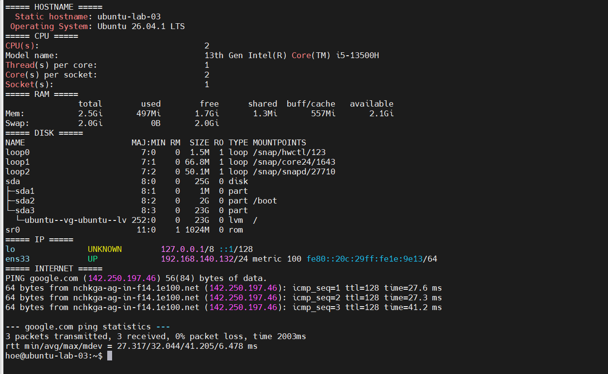

#### Kiểm tra thin provisioning

Trên Windows, chạy lệnh PowerShell xem kích thước file ổ đĩa ảo:

```powershell
Get-ChildItem "D:\UBUNTU\UBUNTU_lap_03" -Filter *.vmdk | Select-Object Name, @{N="Size(GB)";E={[math]::Round($_.Length/1GB,2)}}
```

- **Kết quả:** file `ubuntu-lab-03.vmdk` chỉ chiếm **5.15 GB** trên ổ cứng thật, trong khi máy ảo nhìn thấy ổ **25 GB** (khoảng 21%).
- Dung lượng file xấp xỉ lượng dữ liệu thực tế trong máy ảo (đã dùng 5.4G theo `df -h`).
- Điều này chứng minh **thin provisioning**: file ổ đĩa chỉ chiếm dung lượng thật bằng phần dữ liệu đã ghi và sẽ lớn dần khi máy ảo lưu thêm dữ liệu.

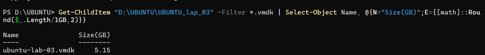

### Bước 14: Tạo Snapshot

**Snapshot** là bản chụp trạng thái của máy ảo tại một thời điểm (ổ đĩa, cấu hình, và cả RAM nếu máy đang chạy). Khi cấu hình sai hoặc hệ thống bị lỗi, có thể quay lại trạng thái này thay vì cài lại từ đầu.

1. Tắt máy ảo trước khi tạo snapshot để snapshot nhẹ và tạo nhanh hơn (không phải lưu nội dung RAM):

   ```bash
   sudo shutdown now
   ```

2. Trong VMware: chọn `ubuntu-lab-03` → **VM → Snapshot → Take Snapshot...**
   - **Name:** `01-cai-xong-os`
   - **Description:** Cài xong Ubuntu Server 26.04.1, mở rộng LVM, SSH hoạt động.
   - Bấm **Take Snapshot**.
3. Kiểm tra trong **VM → Snapshot → Snapshot Manager**: snapshot `01-cai-xong-os` xuất hiện sau trạng thái gốc.

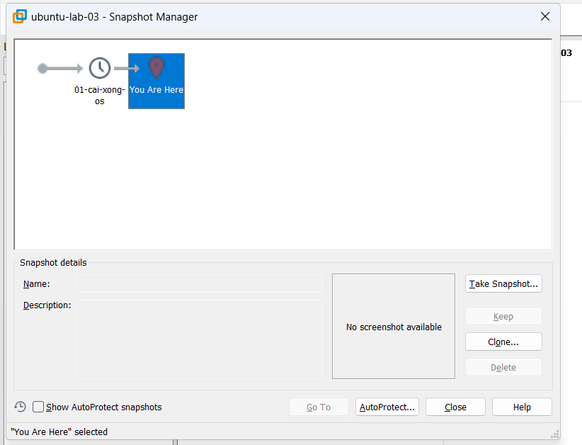

#### Cách hoạt động

- Sau khi tạo snapshot, file ổ đĩa gốc `ubuntu-lab-03.vmdk` bị khoá ở chế độ chỉ đọc.
- Mọi dữ liệu ghi mới được lưu vào file ổ đĩa phụ (**delta disk**) dạng `ubuntu-lab-03-000001.vmdk`.
- Khi quay lại snapshot, VMware bỏ file delta này và dùng lại ổ đĩa gốc.

#### Quay lại snapshot

- **VM → Snapshot → Revert to Snapshot**, hoặc chọn snapshot trong **Snapshot Manager → Go To**.

> **Lưu ý:**
> - Snapshot **không thay thế cho backup** vì vẫn phụ thuộc vào file ổ đĩa gốc; nếu file gốc hỏng thì snapshot cũng không dùng được.
> - Không nên giữ quá nhiều snapshot lâu dài vì file delta lớn dần, tốn dung lượng và làm giảm hiệu năng ổ đĩa.
## Phần 4:  Cấu hình mạng cho máy ảo: NAT, Host-only, Bridged

Mục tiêu: cấu hình 2 máy ảo `ubuntu-lab-01` và `ubuntu-lab-03` lần lượt ở 3 chế độ mạng NAT, Host-only, Bridged; kiểm tra kết nối giữa máy ảo với máy ảo, máy ảo với máy thật và máy ảo với Internet để so sánh 3 chế độ.

### 1. Lý thuyết

* **vNIC (virtual NIC):** card mạng ảo gắn trong máy ảo. Trong Ubuntu card này có tên `ens33`, dùng driver `e1000` – VMware giả lập card mạng Intel 82545EM để hệ điều hành khách nhận diện như một card mạng thật.
* **Virtual switch (VMnet):** switch ảo do VMware tạo ra, vNIC của máy ảo được cắm vào một switch ảo. VMware có sẵn 3 switch tương ứng 3 chế độ mạng:

| Chế độ | Switch ảo | Máy ảo nhận IP từ | Mô tả |
|---|---|---|---|
| NAT | VMnet8 | DHCP của VMware | Máy ảo nằm sau một "router" ảo, ra Internet bằng IP của máy thật; bên ngoài không nhìn thấy máy ảo |
| Host-only | VMnet1 | DHCP của VMware | Mạng nội bộ khép kín giữa máy thật và các máy ảo, không có Internet |
| Bridged | VMnet0 | Router của mạng vật lý | Máy ảo nối thẳng vào mạng LAN như một máy tính thật, ngang hàng với máy thật |

### 2. Chuẩn bị

#### 2.1. Các mạng ảo của VMware

* Mở Edit → Virtual Network Editor → Change Settings:
  * VMnet0 – Bridged: nối máy ảo ra mạng vật lý của máy thật, không có DHCP riêng.
  * VMnet1 – Host-only: mạng 192.168.249.0/24, có DHCP.
  * VMnet8 – NAT: mạng 192.168.140.0/24, có DHCP.

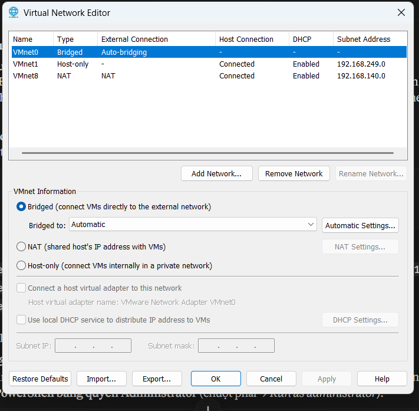

#### 2.2. Địa chỉ IP của máy thật

* Chạy `ipconfig` trên Windows. VMware tạo các card mạng ảo trên máy thật để máy thật tham gia vào mạng ảo:
  * VMware Network Adapter VMnet1: 192.168.249.1 – máy thật trong mạng Host-only.
  * VMware Network Adapter VMnet8: 192.168.140.1 – máy thật trong mạng NAT.
  * Wi-Fi: 192.168.0.100 – máy thật trong mạng LAN gia đình (dùng cho Bridged).

```powershell
ipconfig | Select-String "adapter|IPv4"
```

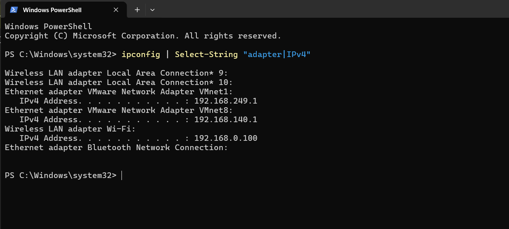

#### 2.3. Cho phép ping vào máy thật

* Windows Firewall mặc định chặn gói ICMP Echo Request (ping) từ bên ngoài. Tạo rule cho phép ping để kiểm tra kết nối từ máy ảo tới máy thật (PowerShell quyền Administrator):

```powershell
New-NetFirewallRule -DisplayName "Allow ICMPv4-In (lab)" -Protocol ICMPv4 -IcmpType 8 -Direction Inbound -Action Allow
```

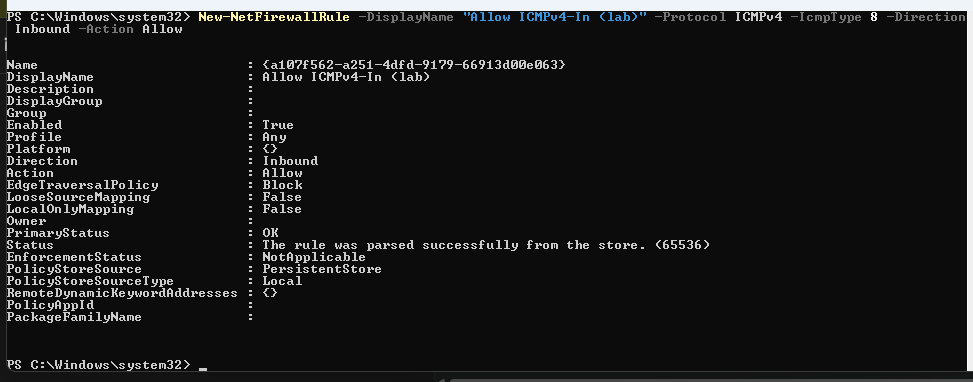

### 3. Chế độ NAT (VMnet8)

#### 3.1. Địa chỉ IP

* Cả 2 máy ảo đặt Network Adapter = NAT, nhận IP qua DHCP của VMware trong dải 192.168.140.0/24:
  * ubuntu-lab-01: 192.168.140.129
  * ubuntu-lab-03: 192.168.140.132

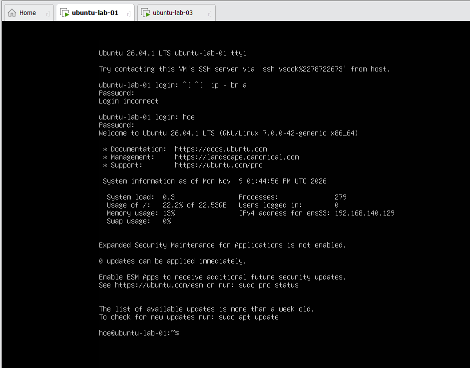

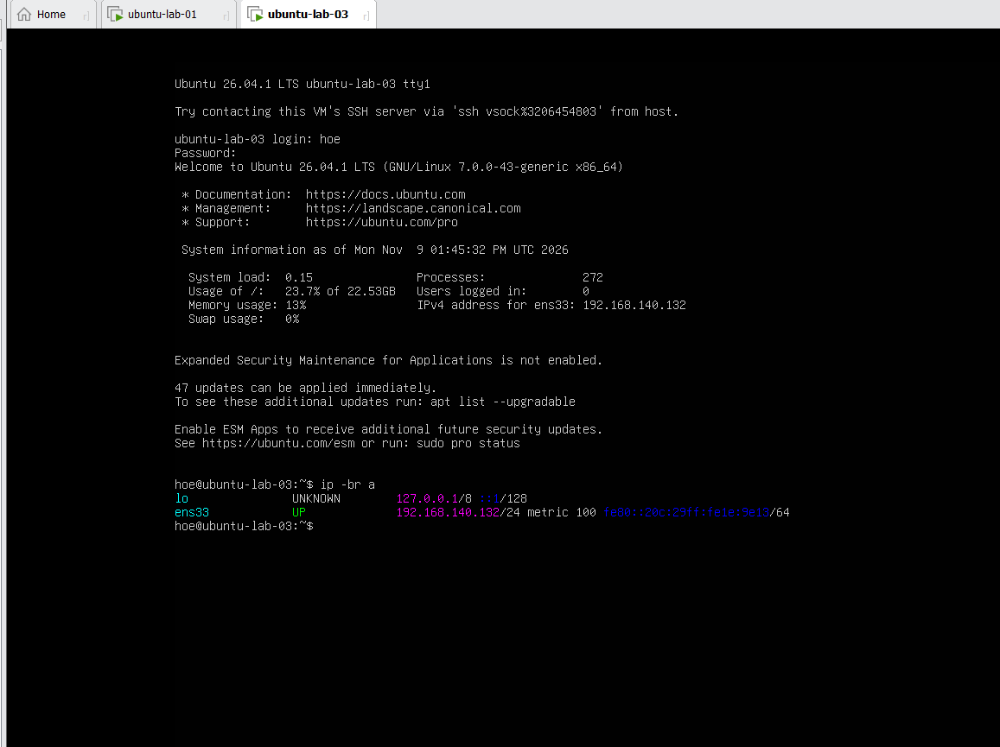

#### 3.2. Kết quả kiểm tra

```bash
ip -br a | grep ens33
ip route | grep default
ping -c 3 192.168.140.132
ping -c 3 192.168.140.1
ping -c 3 google.com
```

* Default gateway của máy ảo là 192.168.140.2: thiết bị NAT ảo của VMware, có nhiệm vụ dịch địa chỉ IP của máy ảo sang IP của máy thật để ra Internet. Địa chỉ 192.168.140.1 là card VMnet8 của máy thật.

| Kiểm tra | Kết quả | Độ trễ TB | TTL |
|---|---|---|---|
| ubuntu-lab-01 ping ubuntu-lab-03 (192.168.140.132) | Thành công, 0% loss | 0.72 ms | 64 |
| ubuntu-lab-01 ping máy thật (192.168.140.1) | Thành công, 0% loss | 0.52 ms | 128 |
| ubuntu-lab-01 ping Internet (google.com) | Thành công, 0% loss | 23.7 ms | 128 |
| Máy thật ping máy ảo (192.168.140.129, 192.168.140.132) | Thành công, 0% loss | < 1 ms | 64 |

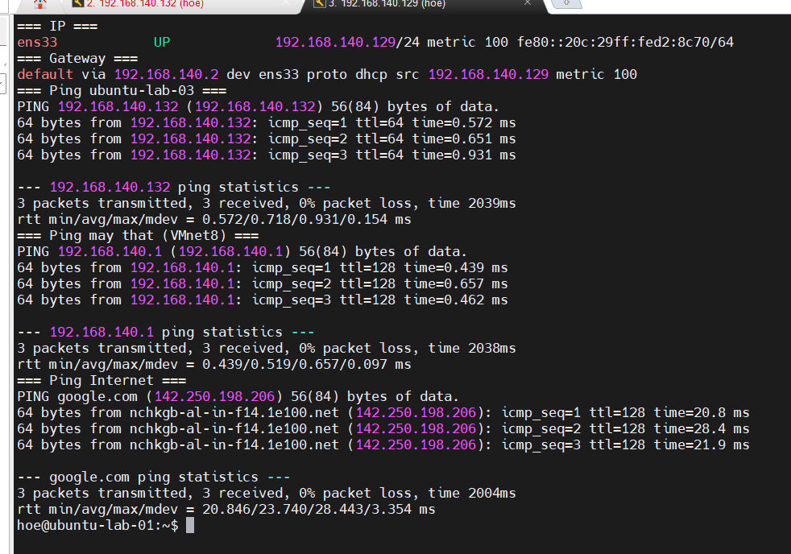

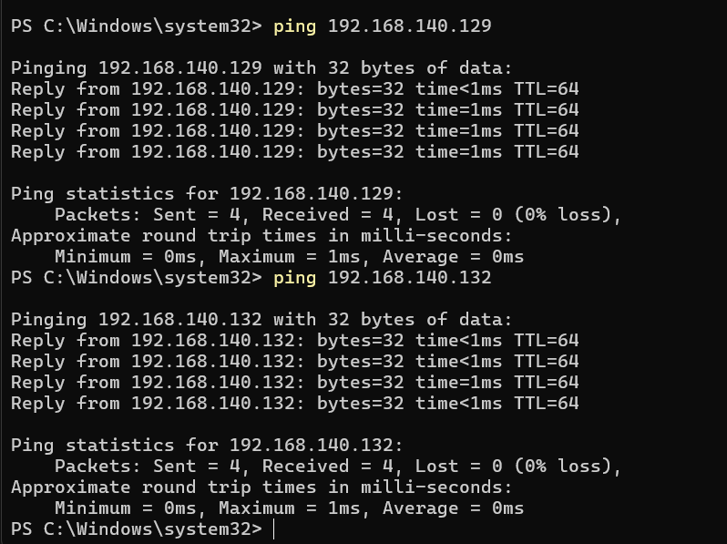

#### 3.3. Nhận xét

* Các máy ảo cùng mạng NAT giao tiếp trực tiếp với nhau qua switch ảo VMnet8 (TTL 64 – giá trị mặc định của Linux, không đi qua router).
* Máy ảo truy cập được Internet. Gói tin trả về từ google.com có TTL 128 (giá trị mặc định của Windows), cho thấy gói tin được dịch vụ NAT của VMware chạy trên máy thật tạo lại: máy ảo "ẩn" sau địa chỉ IP của máy thật.
* Máy thật truy cập được máy ảo qua card VMnet8. Các thiết bị khác trong mạng LAN không truy cập trực tiếp được máy ảo vì máy ảo nằm sau NAT; muốn truy cập phải cấu hình port forwarding trong NAT Settings.

### 4. Chế độ Host-only (VMnet1)

#### 4.1. Địa chỉ IP

* Đổi Network Adapter của cả 2 máy ảo sang Host-only (VM → Settings → Network Adapter → Host-only). Khi đổi, card mạng ảo được reset (log kernel: `e1000 ... ens33: Reset adapter`), Ubuntu tự xin IP mới qua DHCP của VMware trong dải 192.168.249.0/24:
  * ubuntu-lab-01: 192.168.249.128
  * ubuntu-lab-03: 192.168.249.129

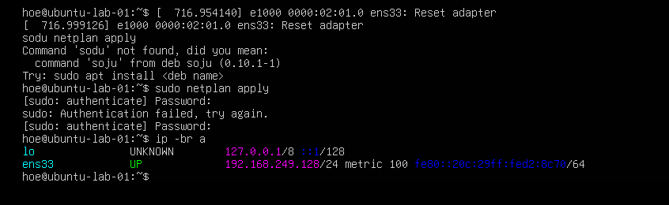

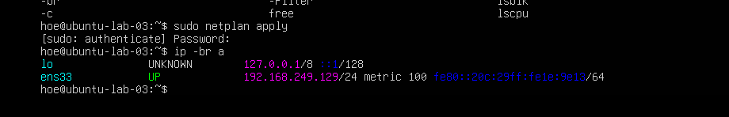

#### 4.2. Kết quả kiểm tra

```bash
ip route
ping -c 3 192.168.249.129
ping -c 3 192.168.249.1
ping -c 3 -W 2 8.8.8.8
ping -c 3 google.com
```

* Bảng định tuyến (`ip route`) không có default gateway, chỉ có đường đến mạng nội bộ 192.168.249.0/24 → máy ảo không có đường ra ngoài.

| Kiểm tra | Kết quả | Độ trễ TB | TTL |
|---|---|---|---|
| ubuntu-lab-01 ping ubuntu-lab-03 (192.168.249.129) | Thành công, 0% loss | 0.70 ms | 64 |
| ubuntu-lab-01 ping máy thật (192.168.249.1) | Thành công, 0% loss | 1.22 ms | 128 |
| ubuntu-lab-01 ping 8.8.8.8 | Thất bại: Network is unreachable | – | – |
| ubuntu-lab-01 ping google.com | Thất bại: Temporary failure in name resolution | – | – |
| Máy thật ping máy ảo (192.168.249.128, 192.168.249.129) | Thành công, 0% loss | < 1 ms | 64 |

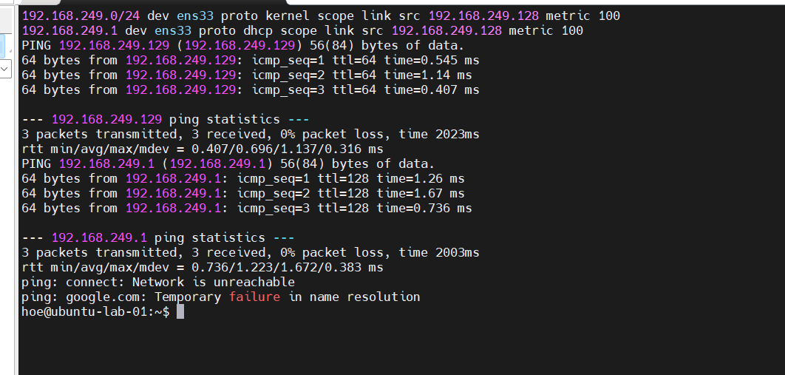

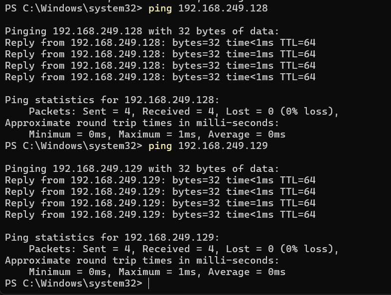

#### 4.3. Nhận xét

* Các máy ảo và máy thật giao tiếp được với nhau qua switch ảo VMnet1.
* Máy ảo không truy cập được Internet: ping 8.8.8.8 báo `Network is unreachable` do không có default gateway; ping google.com lỗi phân giải tên miền do không liên lạc được DNS server bên ngoài.
* Host-only tạo một mạng nội bộ khép kín, cách ly với bên ngoài.

### 5. Chế độ Bridged (VMnet0)

#### 5.1. Cấu hình VMnet0

* Mặc định VMnet0 để Bridged to: Automatic. Khi chọn thủ công cần chọn đúng card mạng vật lý; chọn nhầm card ảo *Microsoft Wi-Fi Direct Virtual Adapter* (card dùng cho hotspot/Wi-Fi Direct) thì máy ảo sẽ không nhận được IP.

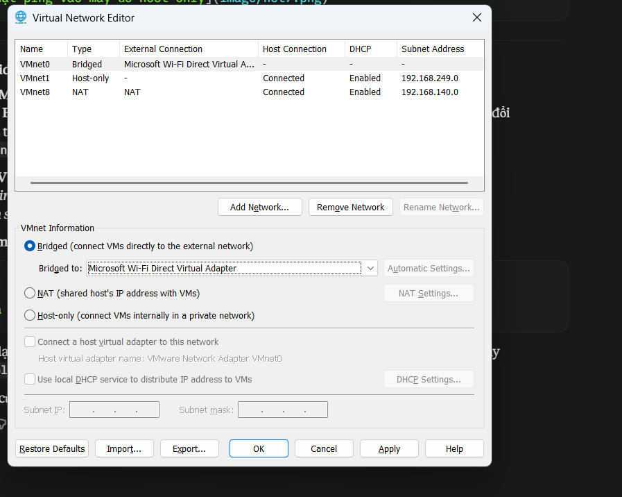

* Chỉ định VMnet0 bridge vào card Wi-Fi vật lý đang kết nối mạng: **MediaTek Wi-Fi 6E MT7902 Wireless LAN Card** (tên card thật xem bằng lệnh `Get-NetAdapter -Name "Wi-Fi" | Select-Object Name, InterfaceDescription`).

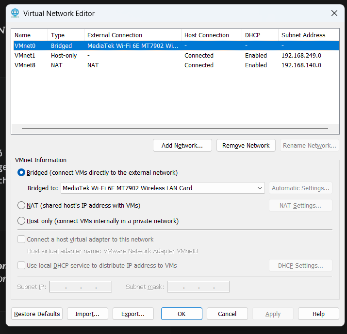

#### 5.2. Địa chỉ IP

* Đổi Network Adapter của cả 2 máy ảo sang Bridged. Máy ảo nhận IP từ DHCP của router Wi-Fi gia đình, cùng dải 192.168.0.0/24 với máy thật (192.168.0.100):
  * ubuntu-lab-01: 192.168.0.103
  * ubuntu-lab-03: 192.168.0.104
* Default gateway là 192.168.0.1 – router Wi-Fi gia đình (ở chế độ NAT là thiết bị NAT ảo 192.168.140.2 của VMware).

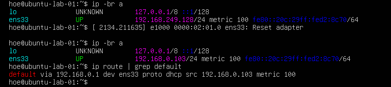

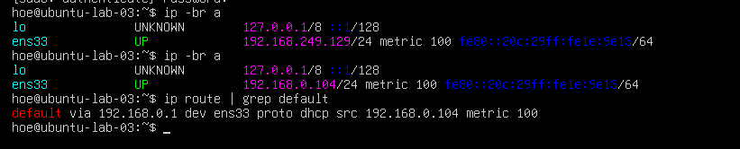

#### 5.3. Kết quả kiểm tra

```bash
ping -c 3 192.168.0.104
ping -c 3 192.168.0.100
ping -c 3 192.168.0.1
ping -c 3 google.com
```

| Kiểm tra | Kết quả | Độ trễ TB | TTL |
|---|---|---|---|
| ubuntu-lab-01 ping ubuntu-lab-03 (192.168.0.104) | Thành công, 0% loss | 0.71 ms | 64 |
| ubuntu-lab-01 ping máy thật (192.168.0.100) | Thành công, 0% loss | 0.34 ms | 128 |
| ubuntu-lab-01 ping router (192.168.0.1) | Thành công, 0% loss | 5.06 ms | 64 |
| ubuntu-lab-01 ping Internet (google.com) | Thành công, 0% loss | 25.6 ms | 113 |
| Máy thật ping máy ảo (192.168.0.103, 192.168.0.104) | Thành công, 0% loss | < 1 ms | 64 |

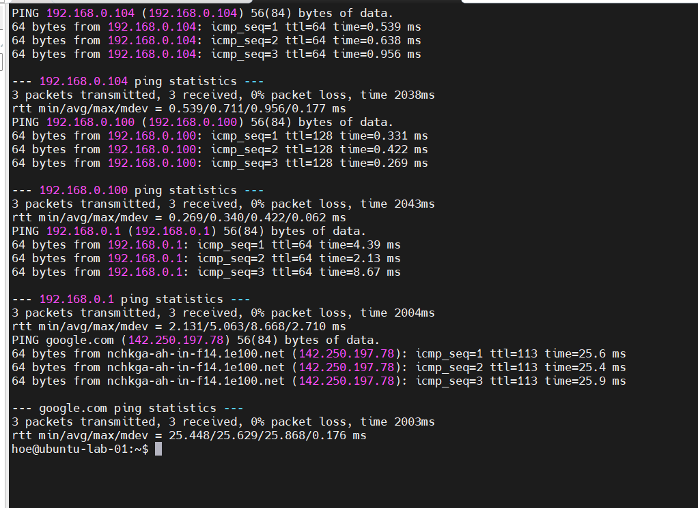

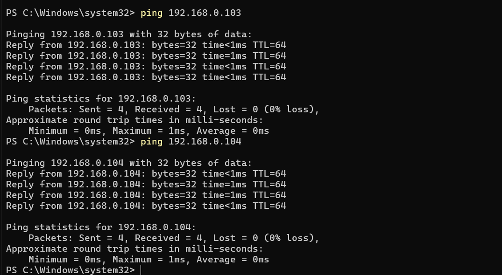

#### 5.4. Nhận xét

* Máy ảo trở thành một thiết bị độc lập trong mạng LAN, ngang hàng với máy thật: có IP riêng do router cấp và giao tiếp trực tiếp với router.
* Ping router có độ trễ cao hơn (~5 ms) vì gói tin đi qua sóng Wi-Fi thật tới router, trong khi ping máy thật chỉ đi trong nội bộ laptop.
* TTL của gói trả về từ google.com là 113 (ở chế độ NAT là 128): ở Bridged gói tin đi thật qua các router trên Internet, mỗi router giảm TTL đi 1; còn ở NAT gói trả về được dịch vụ NAT của VMware trên máy thật tạo lại nên mang TTL mặc định 128 của Windows.

### 6. So sánh 3 chế độ mạng

| Tiêu chí | NAT (VMnet8) | Host-only (VMnet1) | Bridged (VMnet0) |
|---|---|---|---|
| Dải IP máy ảo | 192.168.140.0/24 | 192.168.249.0/24 | 192.168.0.0/24 (cùng mạng LAN) |
| Cấp IP bởi | DHCP của VMware | DHCP của VMware | Router Wi-Fi |
| Default gateway | 192.168.140.2 (NAT ảo của VMware) | Không có | 192.168.0.1 (router thật) |
| Máy ảo ↔ máy ảo | ✅ | ✅ | ✅ |
| Máy thật ↔ máy ảo | ✅ | ✅ | ✅ |
| Máy ảo → Internet | ✅ | ❌ | ✅ |
| Thiết bị khác trong LAN → máy ảo | ❌ | ❌ | ✅ |
| TTL khi ping google.com | 128 | – | 113 |

* **NAT:** máy ảo ra Internet qua IP của máy thật, bên ngoài không nhìn thấy máy ảo. An toàn, không phụ thuộc mạng bên ngoài, là chế độ mặc định. Phù hợp cho máy ảo cá nhân cần Internet để cài đặt, cập nhật.
* **Host-only:** mạng nội bộ khép kín giữa máy thật và các máy ảo, không có Internet. Phù hợp cho môi trường thử nghiệm cần cách ly, hoặc mạng riêng giữa các máy chủ (ví dụ web server ↔ database server).
* **Bridged:** máy ảo như một máy tính thật trong mạng LAN, có IP riêng từ router. Phù hợp khi cần cho thiết bị khác truy cập dịch vụ trên máy ảo. Phụ thuộc mạng vật lý: một số mạng Wi-Fi công cộng/công ty có thể không cấp IP cho máy ảo; IP thay đổi khi đổi mạng Wi-Fi.
* Khi dùng Bridged nên chỉ định rõ card mạng vật lý trong Virtual Network Editor thay vì Automatic để tránh VMware chọn nhầm card ảo.
### 7. Kiểm tra kết nối dịch vụ giữa 2 máy ảo (SSH)
* Ở chế độ Bridged, từ ubuntu-lab-01 (192.168.0.103) SSH sang ubuntu-lab-03 (192.168.0.104):

```bash
ssh hoe@192.168.0.104
hostname
```

* Lần đầu kết nối, SSH hiển thị fingerprint khoá máy chủ ED25519 (SHA256:7IjDfR0tw...) và hỏi có tin cậy không → nhập yes, khoá được lưu vào ~/.ssh/known_hosts. Fingerprint này trùng với khoá do cloud-init sinh ra ở lần khởi động đầu tiên của ubuntu-lab-03, giúp xác thực đúng máy chủ và chống giả mạo (man-in-the-middle).
* Sau khi nhập mật khẩu, đăng nhập thành công; lệnh hostname trả về ubuntu-lab-03 → đang làm việc trên máy ảo thứ hai.
* Kết luận: 2 máy ảo không chỉ thông mạng (ping) mà còn sử dụng được dịch vụ của nhau qua mạng ảo, đáp ứng yêu cầu tạo 2 máy ảo kết nối được với nhau.

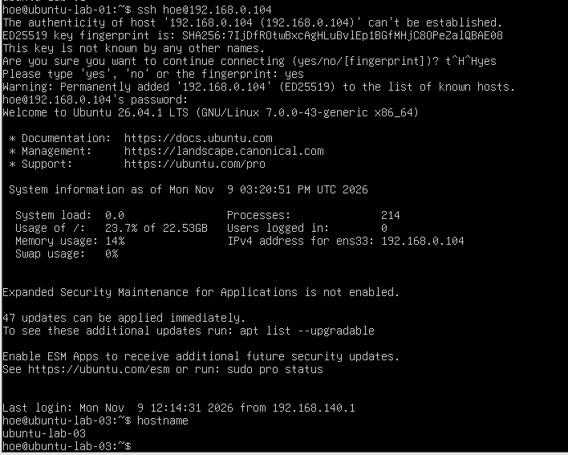
### 8. Kết thúc lab

* Đưa 2 máy ảo về chế độ NAT để dùng cho các bài tiếp theo.
* Xoá rule firewall cho phép ping để khôi phục cấu hình bảo mật mặc định của máy thật:

```powershell
Remove-NetFirewallRule -DisplayName "Allow ICMPv4-In (lab)"
```
