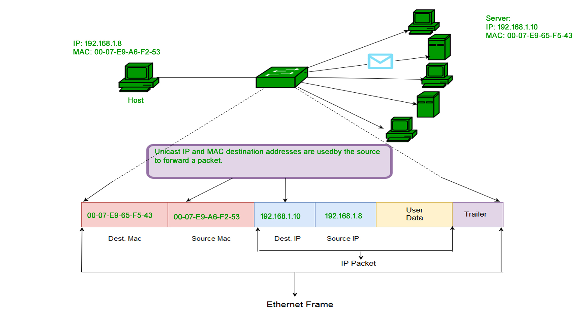
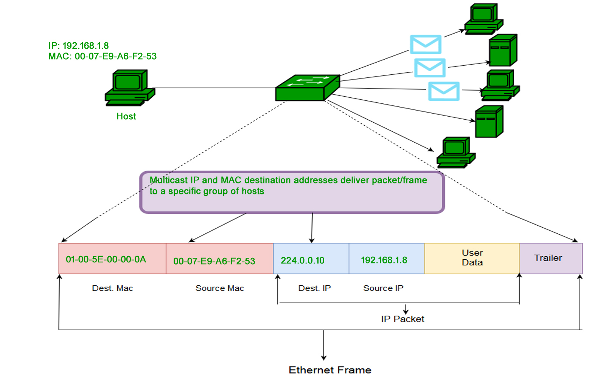
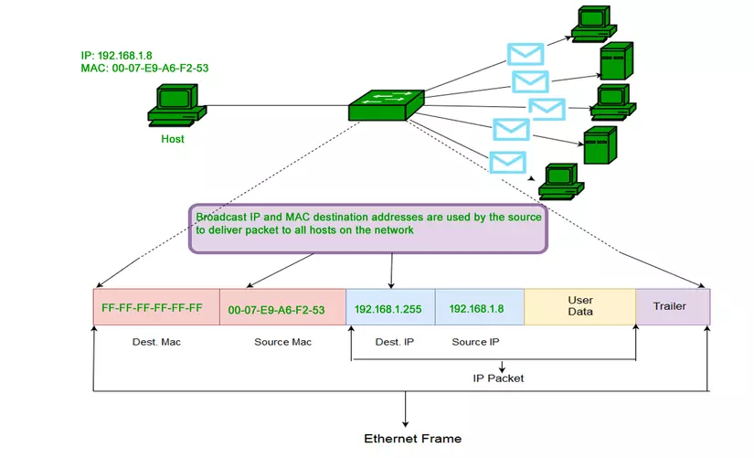
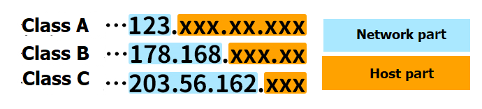
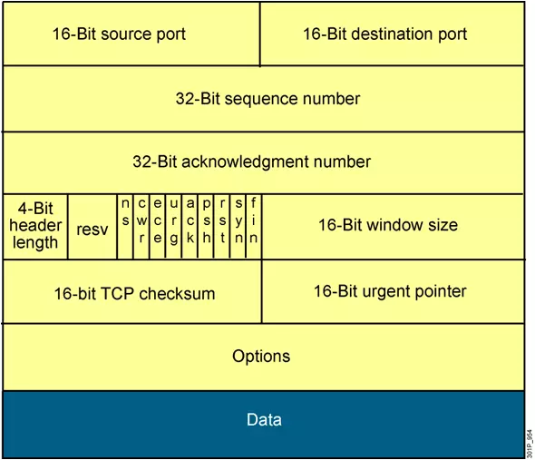
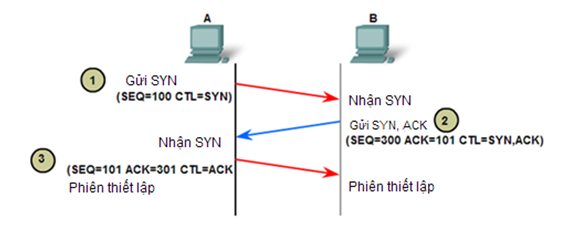
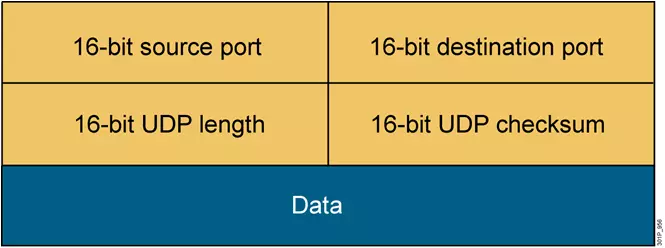

# I Mô hình OSI 7 tầng 

Mô hình OSI (Open Systems Interconnection), hay mô hình tham chiếu kết nối các hệ thống mở là một mô hình khái niệm được phát triển bởi Tổ chức Quốc tế về Tiêu chuẩn hóa (ISO) để hỗ trợ trong việc thiết kế và hiểu cách thức hoạt động của các giao tiếp trong mạng máy tính.   
Mô hình bao gồm 7 tầng riêng biệt nhưng chúng liên kết chặt chẽ với nhau, mỗi tầng đều có nhiệm vụ gửi/nhận dữ liệu từ tầng kề trên hoặc kề dưới nó. Tại thiết bị gửi, dữ liệu xuất phát từ tầng ứng dụng (Application layer), lần lượt được chuyển tiếp và xử lý qua mỗi tầng, cho tới tầng vật lý (Physical layer); bên nhận thu được dữ liệu từ tầng vật lý, chuyển tiếp và xử lý lần lượt qua các tầng, cho tới tầng ứng dụng, thiết bị nhận đón tiếp dữ liệu tại đây.   
Mô hình được áp dụng vào đầu những năm 1980, bao gồm 7 tầng/lớp (layer): 

* Tầng vật lý (Physical layer)  
* Tầng liên kết dữ liệu (Data link layer)  
* Tầng mạng (Network layer)  
* Tầng giao vận (Transport layer)  
* Tầng phiên (Session layer)  
* Tầng trình diễn (Presentation layer)  
* Tầng ứng dụng (Application layer)

## 1 Tầng vật lý (Physical layer)

Là tầng thấp nhất trong mô hình OSI, tầng vật lý thực hiện chức năng chuyển tiếp dữ liệu từ kênh truyền nguồn tới kênh truyền đích. Dữ liệu trong tầng vật lý được biểu diễn dưới dạng dãy bit 0 và 1\. Sau khi nhận được dữ liệu từ kênh truyền khác, tầng vật lý thực hiện chuyển tiếp dữ liệu lên tầng liên kết dữ liệu.   
Tầng vật lý bao gồm các chức năng: 

- Biểu diễn bit: Biểu diễn dữ liệu số thành tín hiệu vật lý để truyền trên phương tiện vật lý   
- Kiểm soát tốc độ dữ liệu: Điều chỉnh tốc độ truyền dữ liệu tức là số lượng bit truyền trên 1 kênh trong 1 đơn vị thời gian  
- Đồng bộ hóa các bit (Bit synchronization): Đảm bảo người nhận và người gửi đồng bộ về thời gian khi truyền và nhận từng bit, để tránh hiểu nhầm về dữ liệu đang được truyền.  
- Cấu hình đường truyền: Thiết lập cấu hình vật lý của đường truyền, bao gồm cài đặt các thiết bị như bộ định tuyến, switch, và hub.  
- **Cấu trúc liên kết vật lý (Topology):** Xác định cách bố trí cấu trúc của mạng, chẳng hạn như cấu hình Bus, Star (Hình sao) hoặc Mesh (Lưới).  
- **Chế độ truyền tải:** Xác định hướng của luồng dữ liệu, sử dụng các chế độ như Simplex (một chiều), Half-Duplex (hai chiều, nhưng luân phiên) hoặc Full-Duplex (hai chiều đồng thời).


## 2 Tầng liên kết dữ liệu

Tầng liên kết dữ liệu là cầu nối giữa phần cứng vật lý và mạng logic, đảm bảo dữ liệu được truyền tin cậy từ nút này sang nút khác. Mục tiêu chính của tầng này là đảm bảo quá trình truyền dữ liệu qua môi trường vật lý không xảy ra lỗi. 

- **Đóng gói dữ liệu:** Ở lớp này, các gói dữ liệu nhận từ lớp mạng được chia thành các đơn vị dễ quản lý hơn gọi là frame. Quá trình này được thực hiện bằng cách thêm các bit bắt đầu và kết thúc để thiết bị nhận biết một đơn vị dữ liệu kết thúc ở đâu và đơn vị tiếp theo bắt đầu từ đâu.  
- **Địa chỉ và phần cứng:** Lớp liên kết dữ liệu sử dụng địa chỉ MAC, hay địa chỉ vật lý, để xác định các thiết bị trong mạng. Lớp này đóng gói địa chỉ MAC của thiết bị gửi và thiết bị nhận vào phần header của frame. Các thiết bị phổ biến hoạt động ở lớp này là switch và bridge.

## 3 Tầng mạng

Tầng Mạng quản lý việc truyền dữ liệu giữa các máy chủ trên các mạng khác nhau bằng cách xử lý việc định địa chỉ logic và tìm đường dẫn.

- **Đơn vị dữ liệu:** Các phân đoạn dữ liệu được đóng gói thành các Gói (Packets).  
- **Định địa chỉ logic:** Gán các địa chỉ IP duy nhất (của người gửi và người nhận) vào phần đầu của gói để nhận dạng các thiết bị trên toàn cầu.  
- **Định tuyến (Routing):** Xác định đường dẫn vật lý hiệu quả nhất từ nguồn đến đích qua các mạng được kết nối với nhau.  
- **Phần cứng:** Được triển khai chủ yếu qua các Router (Bộ định tuyến) và Switch.  
- **Liên mạng (Inter-networking):** Tạo điều kiện giao tiếp giữa các mạng khác biệt bằng cách hướng lưu lượng truy cập đến đúng đích.

## 4 Tầng giao vận 

Tầng Giao vận đảm bảo việc phân phối toàn bộ các thông điệp từ đầu cuối đến đầu cuối (end-to-end). Tầng này hoạt động như một cầu nối, cung cấp các dịch vụ cho Tầng Ứng dụng đồng thời sử dụng cơ sở hạ tầng của Tầng Mạng để đảm bảo dữ liệu đến đúng ứng dụng trên máy chủ đích. 

- **Đơn vị dữ liệu:** Dữ liệu được chia nhỏ thành các Phân đoạn (Segments).  
- **Định địa chỉ Điểm Dịch vụ:** Sử dụng các Số Cổng (Port Numbers, ví dụ: Cổng 80 cho lưu lượng web) để đảm bảo dữ liệu được phân phối đến quy trình hoặc ứng dụng cụ thể dự kiến, chứ không chỉ đơn thuần là đến thiết bị.  
- **Phân đoạn & Lắp ráp lại:** Chia các thông điệp lớn thành các phân đoạn nhỏ hơn để truyền đi và lắp ráp lại chúng theo đúng thứ tự tại đích đến.  
- **Các giao thức:** Các giao thức phổ biến bao gồm TCP (đáng tin cậy) và UDP (nhanh chóng).  
  - *Hướng kết nối (TCP):* Yêu cầu một quá trình "bắt tay" (handshake) để thiết lập kết nối; đảm bảo độ tin cậy thông qua việc kiểm tra lỗi và xác nhận (acknowledgements).  
  - *Không kết nối (UDP):* Gửi dữ liệu ngay lập tức mà không cần kết nối chính thức; nhanh hơn nhưng không có gì đảm bảo dữ liệu sẽ được phân phối tới nơi.

## 5 Tầng phiên

Lớp phiên chịu trách nhiệm thiết lập, duy trì và kết thúc phiên giao tiếp giữa hai thiết bị. Một phiên là khoảng thời gian kết nối được mở để hai bên trao đổi dữ liệu.

- **Vòng đời phiên:** Quản lý việc thiết lập, duy trì và kết thúc kết nối giữa các ứng dụng.  
- **Xác thực và bảo mật:** Đảm bảo các bên giao tiếp đã được xác minh và kết nối được bảo mật.  
- **Đồng bộ hóa:** Chèn các điểm kiểm tra vào luồng dữ liệu. Nhờ đó, nếu xảy ra lỗi, quá trình truyền có thể tiếp tục từ điểm đã lưu gần nhất thay vì phải bắt đầu lại từ đầu.  
- **Kiểm soát hội thoại:** Xác định giao tiếp diễn ra theo dạng half-duplex, tức hai bên thay phiên nhau truyền dữ liệu, hoặc full-duplex, tức hai bên truyền dữ liệu đồng thời.


## 6 Tầng trình diễn

Lớp trình bày có nhiệm vụ chuẩn bị dữ liệu để lớp ứng dụng có thể đọc và xử lý. Lớp này thường đảm nhiệm ba công việc chính: chuyển đổi định dạng dữ liệu, mã hóa hoặc giải mã dữ liệu và nén dữ liệu. 

* **Chuyển đổi:** Lấy dữ liệu từ lớp ứng dụng và chuyển đổi thành định dạng tiêu chuẩn để truyền qua mạng, giúp xử lý sự khác biệt về cách biểu diễn dữ liệu giữa các hệ thống khác nhau.  
* **Tiêu chuẩn và định dạng:** Xử lý việc mã hóa nội dung đa phương tiện theo các tiêu chuẩn như JPEG, MPEG và GIF.  
* **Mã hóa và giải mã:** Cung cấp bảo mật bằng cách chuyển văn bản thuần thành văn bản mã hóa và ngược lại thông qua các giá trị khóa. Quá trình này thường được xử lý bởi các giao thức như TLS/SSL.  
* **Nén dữ liệu:** Giảm tổng số bit cần truyền, từ đó cải thiện hiệu quả và tốc độ truyền dữ liệu trên mạng.

## 7 Tầng ứng dụng 

Lớp ứng dụng là lớp gần nhất với người dùng trong mô hình OSI. Đây là lớp cung cấp các giao thức để phần mềm có thể giao tiếp qua mạng.

- **Giao diện người dùng:** Hoạt động như một cửa sổ để các ứng dụng mạng, chẳng hạn trình duyệt web hoặc ứng dụng email, truy cập các dịch vụ mạng.  
- **Giao thức cốt lõi:** Sử dụng các giao thức cấp cao như HTTP/HTTPS cho web, SMTP cho email, FTP cho truyền tệp và DNS cho phân giải tên miền.  
- **Network Virtual Terminal (NVT):** Cho phép người dùng đăng nhập và tương tác với máy chủ từ xa như thể họ đang trực tiếp thao tác tại thiết bị đầu cuối.  
- **File Transfer, Access, and Management (FTAM):** Cung cấp khuôn khổ để người dùng truy xuất, quản lý và thao tác với các tệp được lưu trữ trên máy tính từ xa.  
- **Directory Services:** Cung cấp khả năng truy cập cơ sở dữ liệu phân tán để quản lý thông tin tổng thể về các đối tượng và dịch vụ khác nhau trong mạng.

# II MAC address

MAC address (Media Access Control address) là một địa chỉ vật lý hoặc địa chỉ phần cứng được gán cho mỗi thiết bị mạng. Đây là một định danh duy nhất được nhúng vào card mạng (NIC \- Network Interface Controller) của mỗi thiết bị, giúp xác định và quản lý thiết bị trên một mạng cục bộ (LAN). Địa chỉ MAC có độ dài 48 bit (6 byte), thường được biểu diễn dưới dạng sáu cặp số hexa, ví dụ: **00:1A:2B:3C:4D:5E**. 

## 1 Cấu trúc 

Chúng ta thường thấy địa chỉ MAC có cấu trúc gồm 6 nhóm, mỗi nhóm gồm hai ký tự (chữ cái hoặc số) được ngăn cách bởi dấu hai chấm (:). Ngoài ra, địa chỉ MAC cũng có thể sử dụng dấu \- hoặc . ngăn cách. Cụ thể, địa chỉ MAC có cấu trúc 48 bit, biểu diễn dưới dạng hệ hexa (thập lục phân), chia làm hai phần: 

- Phần Organizational Unique Identifier (OUI)  
- Phần Network Interface Controller (NIC)

### 1.1 Organizational Unique Identifier (OUI)

Phần Organizational Unique Identifier (OUI) trong một địa chỉ MAC gồm  
24 bit đầu (6 ký tự trước), chỉ nhà sản xuất thiết bị, được IEEE quản lý và cấp phát. Mỗi nhà sản xuất được cung cấp một OUI duy nhất, giúp xác định nguồn gốc phần cứng. 

### 1.2 Network Interface Controller (NIC)

Phần Network Interface Controller (NIC) trong một địa chỉ MAC gồm 24 bit sau (6 ký tự cuối), là định danh duy nhất cho thiết bị, do nhà sản xuất quyết định.

## 2 Phân loại địa chỉ MAC

 Trong mạng máy tính, địa chỉ MAC có thể được phân loại thành 3 kiểu chính: Unicast, Multicast, và Broadcast. Mỗi loại đều có ứng dụng và mục đích sử dụng riêng, phù hợp với các tình huống và nhu cầu khác nhau trong mạng. 

### 2.1 Unicast 

Unicast Addresses là địa chỉ MAC được sử dụng để chỉ định một thiết bị cụ thể trên mạng. Khi một gói tin được gửi đến một địa chỉ Unicast, nó sẽ chỉ được chuyển đến thiết bị đó. Đây là hình thức giao tiếp one-to-one, phổ biến nhất trong mạng máy tính, cho phép giao tiếp trực tiếp giữa hai thiết bị.   
Ví dụ: Giả sử bạn đang gửi một email từ máy tính của mình đến một đồng nghiệp. Máy tính của bạn sẽ tạo một gói tin dữ liệu chứa email đó và gửi nó đến địa chỉ MAC Unicast của máy chủ email hoặc trực tiếp đến máy tính của đồng nghiệp nếu nằm trong cùng một mạng. Trong trường hợp này, gói tin được định tuyến một cách chính xác từ nguồn đến đích mà không làm lộ thông tin cho các thiết bị khác trên mạng.   
  
Mô tả các bước:

* Khởi nguyên gói tin: Host tạo ra một gói tin dữ liệu muốn gửi đến máy chủ.  
* Đóng gói dữ liệu: Gói tin IP sau đó được đóng gói trong một khung Ethernet. Trong khung Ethernet này, địa chỉ MAC nguồn (Source Mac) sẽ là địa chỉ MAC của Host, và địa chỉ MAC đích (Dest. Mac) sẽ là địa chỉ MAC của máy chủ.  
* Truyền gói tin: Gói tin được truyền đi qua mạng. Mỗi thiết bị mạng (như switch hoặc router) sẽ sử dụng địa chỉ MAC đích để xác định nơi gửi gói tin tiếp theo.  
* Nhận gói tin: Máy chủ nhận gói tin, kiểm tra địa chỉ MAC đích và xác định rằng gói tin là dành cho nó. Nó sau đó sẽ xử lý gói tin và phản hồi nếu cần thiết.

### 2.2 Multicast

Multicast Addresses được sử dụng để gửi dữ liệu đến một nhóm các thiết bị trên mạng. Một gói tin gửi đến địa chỉ Multicast sẽ được chuyển đến tất cả các thành viên trong nhóm đó. Đây là hình thức giao tiếp one-to-many, hữu ích trong các ứng dụng như phát sóng video hoặc âm thanh trực tiếp, dữ liệu cần được chia sẻ với nhiều người nhận cùng một lúc.   
Ví dụ: Một tổ chức quyết định tổ chức một cuộc họp qua video cho nhiều chi nhánh trên khắp thế giới. Để tiết kiệm băng thông và tối ưu hóa việc phân phối video, cuộc họp được phát qua địa chỉ Multicast. Như vậy, dữ liệu video chỉ được truyền một lần qua mạng nhưng có thể được nhận bởi tất cả các địa điểm đăng ký tham gia, giảm thiểu việc sử dụng băng thông so với việc gửi dữ liệu một cách riêng lẻ đến mỗi địa chỉ Unicast.   
  
Mô tả các bước:

- Tạo gói tin: Host tạo ra một gói tin IP với địa chỉ nguồn là 192.168.1.8 và địa chỉ đích là 224.0.0.10, đây là địa chỉ Multicast dành cho một nhóm cụ thể.  
- Đóng gói vào khung Ethernet: Gói tin IP sau đó được đóng gói trong một khung Ethernet với địa chỉ MAC nguồn là của host và địa chỉ MAC đích là địa chỉ Multicast tương ứng.  
- Phân phối gói tin: Khi khung Ethernet được truyền đi trong mạng, các switch mạng sẽ nhận biết địa chỉ MAC đích là một địa chỉ Multicast và sẽ gửi gói tin đến tất cả các port có host đăng ký nhận gói tin từ địa chỉ Multicast đó.  
- Nhận gói tin bởi nhiều host: Các host trong nhóm đăng ký Multicast sẽ nhận gói tin và xử lý nó. Trong hình, các máy tính có biểu tượng thư mục được hiểu là những máy đã đăng ký với địa chỉ Multicast và sẽ nhận gói tin.

3 Broadcast  
Broadcast Addresses là địa chỉ dùng để gửi dữ liệu đến tất cả các thiết bị trong một mạng cục bộ (LAN). Gói tin gửi đến địa chỉ Broadcast sẽ được phân phối đến mọi thiết bị trong mạng. Đây là hình thức giao tiếp one-to-all, thường được sử dụng để truy vấn thông tin từ tất cả các thiết bị trên mạng hoặc phân phát thông báo quan trọng.   
Ví dụ, trong một mạng cục bộ, khi một máy tính mới được kết nối và cần được cấp phát địa chỉ IP, nó sẽ gửi một yêu cầu DHCP Discover bằng cách sử dụng địa chỉ Broadcast. Yêu cầu này được gửi đến tất cả các thiết bị trên mạng. Máy chủ DHCP, nhận thấy yêu cầu gửi đến địa chỉ Broadcast, sẽ phản hồi với một đề nghị địa chỉ IP bằng cách gửi lại đến địa chỉ MAC Unicast của máy tính mới. Điều này cho phép máy tính mới tự động cấu hình mình với một địa chỉ IP mà không cần sự can thiệp thủ công.   
  
Mô tả các bước:

- Khởi tạo gói tin: Host có địa chỉ IP là 192.168.1.8 và địa chỉ MAC là 00-07-E9-A6-F2-53 tạo ra một gói tin dành cho toàn bộ mạng.  
- Đóng gói Ethernet: Gói tin IP này sau đó được đóng gói trong một khung Ethernet. Địa chỉ MAC đích được đặt là FF-FF-FF-FF-FF-FF, đây là địa chỉ Broadcast dùng để chỉ định tất cả các thiết bị trong mạng.  
- Truyền gói tin: Khi gói tin được gửi đi, mọi thiết bị trên mạng sẽ nhận gói tin này vì nó được gửi đến địa chỉ Broadcast.  
- Nhận gói tin: Mỗi host trong mạng sẽ nhận và xử lý gói tin này. Trong mạng LAN, điều này có nghĩa là mọi máy tính, máy in, hoặc thiết bị mạng khác sẽ nhận được thông tin được gửi.

# III IP address

IP address được định nghĩa là số hiệu mà một thiết bị kết nối với internet sở hữu. IP address được sử dụng nhằm đảm bảo không có sự nhầm lẫn đối tượng giao tiếp trong quá trình trao đổi thông tin trên network. IP address được phân thành nhiều loại và có những quy tắc riêng.  
IP address đảm đương nhiệm vụ như địa chỉ trên internet của Máy tính hay smartphone v.v, dùng để phân biệt các thiết bị này trên Network. 

## 1 Phần Netwwork và phần Host

IP address là 1 dãy các chữ số, hiện nay, phiên bản được sử dụng phổ biến nhất là IPv4. Trong phiên bản này, IP address được cấu tạo gồm 32 bit nhị phân, nhưng do cách viết này khá khó hiểu, mỗi 8 bit sẽ được biểu diễn dưới dạng số thập phân từ 0 đến 255 và ngăn cách nhau bởi dấu “.” (dot). 

Ví dụ về cách biểu diễn IP address dưới dạng thập phân: 10101100.00010000.11111110.00000001 sẽ biểu diễn dưới dạng 172 . 16 . 254 . 1  
Cụ thể hơn, IP address được cầu thành bởi phần Network và phần Host như hình dưới đây. Ranh giới phân cách giữa bộ phận Network và Host sẽ khác nhau tùy thuộc vào IP Address.   


Phần Network dùng để phân biệt IP address thuộc Network nào.  
Phần Host dùng để chỉ IP address thuộc host nào (máy tính nào) trong Network đó. 

### 1.1 class-full address

Trong Class-full address, class được chia thành 5 loại từ A đến E, tuy nhiên, thông thường, ta sử dụng các class từ A đến C. 

Ví dụ, với class A, bộ phận Network sẽ chiếm 8 bit, phần Host chiếm 24 bit. Như vậy, ta chỉ có tổng cộng 124 network nhưng mỗi network có thể kết nối được với khoảng 17 triệu host.

Trong class C, bộ phận Network sẽ chiếm 24 bit, phần Host là 8 bit. Số lượng Network có thể sử dụng lên tới 2.09 triệu network. Tuy nhiên, mỗi network chỉ có khả năng kết nối được 254 host.

### 1.2 Class-less address

Cùng với việc đưa IP address vào sử dụng, người ta đã nhận ra sự lãng phí trong việc phân phối chúng. Hiện tại, số gọi là Sub-net mask đã trở nên phổ biến. Sub-net mask là số dùng để biểu diễn sự phân cách giữa 2 bộ phận network và host.

Đối với class-less address, bằng việc thay đổi sub-net mask, 1 class có thể được chia thành nhiều segment để sử dụng address.

Nhờ vào sub-net mask, ranh giới giữa phần network và host trở nên linh động hơn, có thể được tự do quyết định.

Như những gì tôi đã nói, dưới mắt nhìn của chúng ta, IP address được biểu diễn dưới dạng số thập phân, tuy nhiên, thực tế, nó là 1 dãy số nhị phân.

Khi xem xét IP address và sub-net mask biểu diễn dưới dạng nhị phân, ta thấy:

* Phần được biểu diễn bằng các số 1 của sub-net mask \=\> Phần Network của IP address.  
* Phần được biểu diễn bằng các số 0 của sub-net mask \=\> Phần Host của IP address.

III Port

Port là một điểm ảo trên máy tính để phân biệt các loại kết nối mạng và giúp định tuyến dữ liệu đến đúng dịch vụ hoặc ứng dụng. Mỗi port được gán một số port riêng biệt và được quản lý bởi hệ điều hành.

* Port được chuẩn hóa với mỗi số port gắn với một giao thức cụ thể, ví dụ, port 80 cho HTTP, port 443 cho HTTPS. Các số port giúp phân biệt các dịch vụ mạng chạy trên cùng một địa chỉ IP.  
* Port giúp máy tính nhận diện và xử lý dữ liệu từ mạng, ví dụ: dữ liệu FTP (port 21\) sẽ được chuyển đến ứng dụng FTP, trong khi HTTP (port 80\) sẽ được xử lý bởi trình duyệt web.

# IV Giao thức TCP/UDP

## 1 Giao thức TCP

* TCP là giao thức truyền tải hướng kết nối (connection-oriented), nghĩa là phải thực hiện thiết lập kết nối với đầu xa trước khi thực hiện truyền dữ liệu. Tiến trình thiết lập kết nối ở TCP được gọi là tiến trình ***bắt tay 3 bước*** (*threeway handshake*).  
* Cung cấp cơ chế báo nhận (Acknowledgement) :Khi A gửi dữ liệu cho B, B nhận được thì gửi gói tin cho A xác nhận là đã nhận. Nếu không nhận được tin xác nhận thì A sẽ gửi cho đến khi B báo nhận thì thôi.  
* Cung cấp cơ chế đánh số thứ tự gói tin (*sequencing*) cho các đơn vị dữ liệu được truyền, sử dụng để ráp các gói tin chính xác ở điểm nhận và loại bỏ gói tin trùng lặp.  
* Có các cơ chế điều khiển luồng thích hợp (*flow control*) để tránh nghẽn xảy ra.  
* Hỗ trợ cơ chế full-duplex ( truyền và nhận dữ liệu cùng một lúc)  
* Phục hồi dữ liệu bị mất trên đường truyền ( A gửi B mà không thấy xác nhận sẽ gửi lại) .

Cấu trúc:  


* **Source port và destination port (đều dài 16 bit)**: được sử dụng để định danh cho session của giao thức nào đó trên lớp ứng dụng đang được truyền tải trong TCP segment đang xét  
* **Sequence number (32 bit)**: dùng để đánh số thứ tự gói tin (từ số sequence nó sẽ tính ra được số byte đã được truyền).  
* **Acknowledge number (32 bit)**: : dùng để báo đã nhận được gói tin nào và mong nhận được byte mang số thứ tự nào tiếp theo.  
* **Header length (4 bit)**: cho biết toàn bộ header dài bao nhiêu tính theo đơn vị word(1 Word \= 4 byte).  
* **Các bit reserverd (4 bit)**: đều được thiết lập bằng 0  
* **Các bit control (9 bit)**: các bit dùng để điều khiển cờ (flag) ACK, cờ Sequence ...  
* **Window size (16 bit)**: số lượng byte được thiết bị sẵn sàng tiếp nhận  
* **Checksum (16 bit)**: kiểm tra lỗi của toàn bộ TCP segment  
* **Urgent pointer (16 bit)**: sử dụng trong trường hợp cần ưu tiên dữ liệu  
* **Options (tối đa 32 bit)**: cho phép thêm vào TCP các tính năng khác  
* **Data**: dữ liệu của lớp trên

Cách thức hoạt động:  
TCP hoạt động theo tiến trình bắt tay 3 bước:  


Giả sử host A muốn truyền dữ liệu cho host B thông qua một kết nối TCP. Trước khi thực hiện truyền , host A cần phải thiết lập kết nối TCP với host B việc này được tiến hành thông qua quá trình bắt tay 3 bước như sau:

* **Bước 1**: Host A gửi cho B một gói tin có cờ SYN được bật lên, với số thứ tự được đánh là 100\. Segment đầu tiên này không chứa phần dữ liệu nên không có phần data, tuy nhiên số lượng byte dữ liệu vẫn được tính là một byte cho hoạt động gửi cờ SYN.  
* **Bước 2**: Host B nhận được gói tin thì B gửi lại gói tin có cờ SYN được bật lên, kèm theo đó là cờ ACK để xác nhận.

Giả sử host B thiết lập segment có số thứ tự là 300\. Segment trả lời từ Host B này cũng không có dữ liệu nhưng vẫn được tính là 1 byte cho phần data. Khi phản hồi lại host A, host B cũng cần phải chỉ rõ trong trường ACK sequence số thứ tự của byte kế tiếp mà nó muốn nhận từ host A. Do segment SYN do A gửi qua được tính là 1 byte nên B sẽ mong muốn nhận byte tiếp theo là byte thứ 101 từ A , do đó ACK sequence được đánh số là 101\. (SEQ=300, ACK=101)

* **Bước 3**: Sau khi kết nối đã được thiết lập thì A gửi lại gói tin để đáp ứng nhu cầu của B. Gói tin được đánh số SEQ \= 101 để đáp ứng nhu cầu của B. ACK \=301 dùng để báo là đã nhận được gói tin có SEQ \= 300\.

Sau khi 3 bước được hoàn tất , kết nối TCP được thiết lập giữa host A và B, lúc này 2 host đã có thể truyền dữ liệu được với nhau.

## 2 Giao thức UDP

* Ngược lại với giao thức TCP thì UDP là giao thức truyền tải hướng không kết nối (connectionless). Nó sẽ không thực hiện thao tác xây dựng kết nối trước khi truyền dữ liệu mà thực hiện truyền ngay lập tức khi có dữ liệu cần truyền (kiểu truyền best effort) \=\> truyền tải rất nhanh cho dữ liệu của lớp ứng dụng.  
* Không đảm bảo tính tin cậy khi truyền dữ liệu và không có cơ chế phục hồi dữ liệu ( nó không quan tâm gói tin có đến đích hay không, không biết gói tin có bị mất mát trên đường đi hay không) \=\> dễ bị lỗi.  
* Không thực hiện các biện pháp đánh số thứ tự cho các đơn vị dữ liệu được truyền…  
* Nhanh và hiệu quả hơn đối với các dữ liệu có kích thước nhỏ và yêu cầu khắt khe về thời gian.  
* Bản chất không trạng thái nên UDP hữu dụng đối với việc trả lời các truy vấn nhỏ với số lượng lớn người yêu cầu.

Cấu trúc gói tin UDP  


* **source port** và **destination port(đều 16 bit)**: cho phép định danh một session của một ứng dụng nào đó chạy trên UDP. Có thể coi port chính là địa chỉ của tâng Transport  
* **UDP length(16 bit)**: cho biết chiều dài của toàn bộ UDP datagram tổng cộng bao nhiêu byte. (16 bit thì sẽ có tổng cộng 2^16 byte \= 65536 giá trị (từ 0 \-\> 65535 byte)).  
* **UDP checksum(16 bit)**: sử dụng [thuật toán mã vòng CRC](https://vi.wikipedia.org/wiki/Cyclic_Redundancy_Check) để kiểm lỗi cho toàn bộ UDP datagram và chỉ kiểm tra một cách hạn chế  
* **Data**: dữ liệu tầng trên được đóng gói vào UDP datagram đang xét.

Cách hoạt động UDP:

UDP hoạt động tương tự như TCP nhưng nó không cung cấp kiểm tra lỗi khi truyền gói tin.

Khi một ứng dụng sử dụng UDP, các gói tin chỉ được gửi đến người nhận. Người gửi không đợi để đảm bảo người nhận nhận được gói tin hay không, mà tiếp tục gửi các gói tiếp theo. Nếu người nhận miss mất một vài gói tin UDP thì gói tin đó coi như bị mất vì người gửi sẽ không gửi lại chúng. \=\> Các thiết bị có thể giao tiếp nhanh hơn.

# V Protocol

## 1\. Protocol là gì?

Protocol là một giao thức mạng, tập hợp các quy tắc đã được thiết lập với nhiệm vụ hàng đầu là định dạng, truyền và nhận dữ liệu. Tất cả nhiệm vụ này sẽ được thực hiện sao cho các thiết bị mạng máy tính (Từ server, router đến end point) có thể giao tiếp rõ ràng với nhau. Dù có sự khác biệt về cơ sở hạ tầng, thiết kế hay các tiêu chuẩn cơ bản thì giao thức Protocol vẫn sẽ hỗ trợ tuyệt đối để việc giao tiếp có thể diễn ra tốt nhất.

Để truyền tải dữ liệu thành công thì cần phải có sự chấp nhận của các thiết bị ở 2 phía đầu cuối của một trao đổi liên lạc. Đồng thời, cũng phải tuân theo quy ước của giao thức để gửi, nhận thông tin nhanh chóng nhất. Thêm vào đó, khi tích hợp vào phần mềm, phần cứng có thể hỗ trợ cho giao thức mạng.

2 Cơ chế hoạt động của giao thức   
Các giao thức mạng thường phân chia các quy trình lớn thành nhiều phần nhỏ tương ứng với chức năng, nhiệm vụ trên tất cả cấp độ mạng. Điều này còn được biết đến là mô hình OSI được sử dụng trong mô hình tiêu chuẩn. Như vậy, ta có thể hiểu rằng sẽ có một hoặc nhiều giao thức mạng để xử lý các hoạt động trong quá trình trao đổi, sâu hơn nữa là từng lớp mạng.   
Trong đó, sẽ có 7 lớp mạng mà cần ghi nhớ trong mô hình OSI như sau: 

* **Tầng 1:** Physical Layer (Tầng vật lý), được sử dụng để truyền hoặc nhận các chuỗi bit từ các thiết bị vật lý  
* **Tầng 2:** Data Link-Layer (Tầng liên kết dữ liệu), là tầng có khả năng tạo khung thông tin và kiểm soát mọi luồng tin, các lỗi có thể xảy ra trong tương lai  
* **Tầng 3:** Network Layer (Tầng mạng), có nhiệm vụ đảm bảo mọi thông tin được trao đổi liên tục. Đồng thời, chọn đường đi, công nghệ chuyển mạch phù hợp nhất  
* **Tầng 4:** Transport Layer (Tầng giao vận), hỗ trợ vận chuyển thông tin giữa các máy chủ và chịu toàn bộ trách nhiệm liên quan đến việc kiểm soát các luồng, các lỗi có thể xảy ra  
* **Tầng 5:** Session Layer (Tầng phiên), đây là tầng thiết lập và có thể duy trì, đồng bộ hóa liên lạc giữa các thực thể. Không chỉ vậy, tầng 5 còn có chức năng loại bỏ các phiên truyền đi giữa các app  
* **Tầng 6:** Presentation Layer (Tầng trình diễn), chịu trách nhiệm về việc chuyển đổi thông tin, dữ liệu theo nhu cầu của các ứng dụng  
* **Tầng 7**: Application Layer (Tầng ứng dụng), là tầng cuối cùng và cũng là tầng giúp người dùng giao tiếp trong môi trường mạng

# VI Packet

**Packet** là **một đơn vị dữ liệu** được gửi qua mạng. Dữ liệu lớn (một trang web, một file) không đi nguyên khối mà được **cắt thành nhiều gói nhỏ**, mỗi gói gửi riêng rồi ghép lại ở nơi nhận.

Ví dụ: chuyển một cuốn sách 300 trang qua bưu điện. Bạn không gửi nguyên cuốn sách trong một thùng khổng lồ, mà chia thành 30 phong bì, mỗi phong bì 10 trang, đánh số thứ tự và ghi địa chỉ. Mỗi phong bì là một **packet**.

#### **Cấu trúc một packet**

Một packet gồm hai phần:

```
┌───────────────────┬────────────────────────────┐
│ Header (phần đầu) │ Payload (dữ liệu mang theo)│
└───────────────────┴────────────────────────────┘
```

| Phần | Chứa gì |
| ----- | ----- |
| **Header** | Thông tin điều khiển: IP nguồn, IP đích, độ dài, TTL, giao thức... (giống thông tin trên phong bì) |
| **Payload** | Dữ liệu thật cần gửi (giống nội dung bên trong phong bì) |

